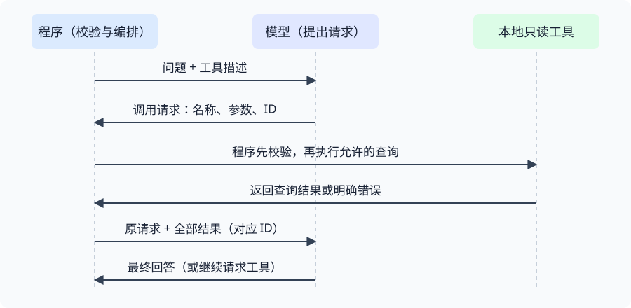

# 工具调用与有界循环

## 模型提出请求，程序校验并执行

工具调用的本质是：模型提出调用请求，程序负责检查和执行，将结果返回模型继续处理和输出。写给模型看的工具描述不是函数实现，也不是执行授权。



从上向下读：程序发送问题与工具描述，模型返回调用请求；程序校验后执行本地函数，再回送结果。模型可以继续请求工具，也可以给出最终回答。常见误解是“模型已经执行了函数”；实际上模型返回的只是请求数据。

本例使用自造的内存题库，按主题只读查询练习名称，不涉及文件或数据库写入。

## 工具函数与描述分开

本地函数实现真实行为，例如 `get_exercise_list(topic)`：先检查非空字符串，再 `strip()` 规范化后查询；未知主题抛 `ValueError`。应先去掉空白再判断键是否存在，否则 `" 二分查找 "` 会被误判为未知主题。

工具描述告诉模型函数名、用途和参数结构：

```python
TOOLS = [{
    "type": "function",
    "function": {
        "name": "get_exercise_list",
        "description": "按主题查询本地题库的练习名称；未知主题报错",
        "parameters": {
            "type": "object",
            "properties": {"topic": {"type": "string"}},
            "required": ["topic"],
            "additionalProperties": False,
        },
    },
}]
```

`required` 声明必需字段，`additionalProperties: False` 声明不接受额外字段。描述中的约束不能替代执行前的本地校验；程序只分派允许的函数名，不使用模型给出的名称执行任意代码。

## arguments 是嵌套的 JSON 字符串

以下为提炼的调用请求，不是函数已经执行后的结果：

```python
tool_call = {
    "id": "call_1",
    "type": "function",
    "function": {
        "name": "get_exercise_list",
        "arguments": '{"topic": "二分查找"}',
    },
}
```

外层是字典，函数信息位于 `tool_call["function"]`，其中 `arguments` 仍是字符串，需要再次 `json.loads()`，再检查字典结构和字段值。不要把外层请求直接当作 `function` 字典。

下面是从实验分派函数提炼的最小实现，`get_exercise_list` 为已有本地查询函数：

```python
import json


def execute_tool(tool_call):
    if not isinstance(tool_call, dict):
        return {"error": "调用请求必须是字典"}
    function = tool_call.get("function")
    if not isinstance(function, dict):
        return {"error": "function 必须是字典"}
    if function.get("name") != "get_exercise_list":
        return {"error": "未知工具"}
    text = function.get("arguments")
    if not isinstance(text, str):
        return {"error": "arguments 必须是 JSON 字符串"}
    try:
        arguments = json.loads(text)
        if not isinstance(arguments, dict) or set(arguments) != {"topic"}:
            return {"error": "参数必须且只能包含 topic"}
        return {"exercises": get_exercise_list(arguments["topic"])}
    except ValueError as error:
        return {"error": str(error)}
```

`JSONDecodeError` 是 `ValueError` 的子类，因此此处把解析失败与查询拒绝都转成错误结果。返回 `error` 不代表查询成功，而是让模型获得明确失败信息；本地校验不合格时不能继续查询。解析与业务校验的区别见[JSON 解析与业务校验](../../languages/python/10_JSON解析与业务校验.md)。

## 保留请求，并回送全部结果

有工具请求时，先保留原 assistant 消息，再为每条请求追加一条 tool 消息：

```python
messages.append(assistant_message)
for tool_call in tool_calls:
    result = execute_tool(tool_call)
    messages.append({
        "role": "tool",
        "tool_call_id": tool_call["id"],
        "content": json.dumps(result, ensure_ascii=False),
    })
# 全部结果追加完之后，才进行下一轮模型请求
```

- `tool_call_id` 对应原请求的 `id`，不是函数名，也不能自己重新编一个编号；
- tool 消息的 `content` 是序列化后的结果字符串，角色必须是 `tool`；
- 同轮有多个调用时，全部执行并回送后再请求模型，不能把下一次模型请求放进工具的 `for` 循环；
- 参数校验与协议校验不同：回送前还需要有效调用 ID。本例代码片段假定 ID 有效，不能据此认为任意畸形请求都能安全回送。

## 正常结束与轮数上限

按本例非思考模式的实现约定：

| 模型消息 | 处理 |
| --- | --- |
| `tool_calls` 缺失或为 `None` | 归一化为空列表；其他非列表值拒绝 |
| 有工具调用 | assistant 的 `content` 可为 `None` 或字符串，不套用普通回答必填规则 |
| 无工具调用且 `finish_reason="stop"` | 回答必须是非空白字符串，才成功返回 |
| 异常结束标记或空最终回答 | 报错，不能当作成功 |

`max_rounds` 包含第一次模型调用。本例默认 3 轮：最后一轮仍请求工具时立即停止，不再执行该轮工具，避免产生无法继续解释的结果。上限为 1 时，模型直接回答可以成功；请求工具则在执行前停止。

模型轮数与 HTTP 重试是两层控制：每轮请求模型可能最多尝试 3 次，所以 3 轮最多发生 9 次 HTTP 尝试，但并不意味着一定调用 9 次，也不保证业务总耗时。重试细节见[错误分类与有限重试](../../languages/python/09_错误分类与有限重试.md)。

需要验证的是结果与控制流：同轮两个工具的 ID 和结果是否一一对应；坏参数是否在查询前拒绝；最后一轮是否不执行工具；`None` 是否被正确处理；空最终回答是否被拒绝。受控提供者能验证这些分支，不等于覆盖了所有真实网络行为。

## 来源与边界

- [只读工具实验源码](https://github.com/lumikok/agent-engineering-lab/blob/e2023a6/03-tool-calling/01-tool_demo.py)：正文只提炼关键部分，完整入口和本地题库见源码。
- [DeepSeek Tool Calls](https://api-docs.deepseek.com/guides/tool_calls/)：本文采用非思考模式的消息回送格式；不是所有厂商接口的统一字段格式。

本例没有写操作、持久化或取消机制。扩展到有副作用的工具时，仍需权限、结果查询与幂等设计，不能直接把 HTTP 超时重试等同于安全重做工具操作。
