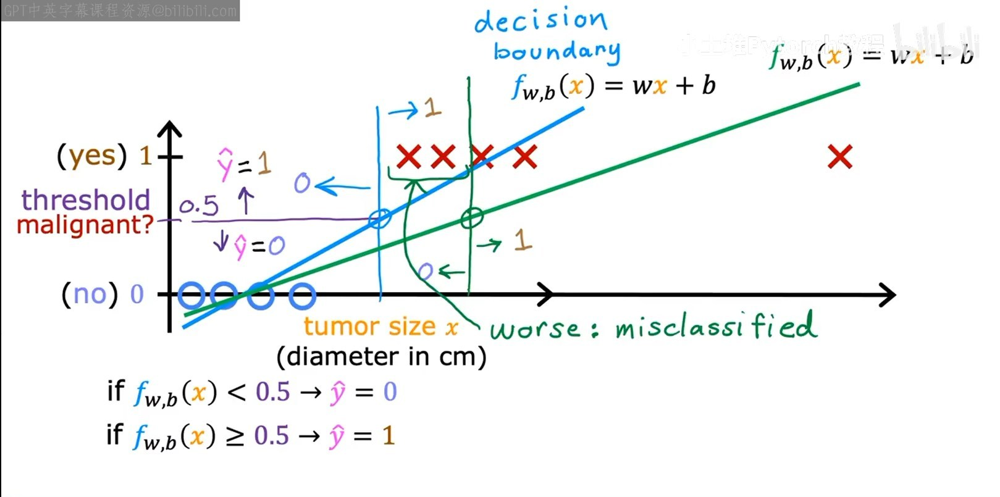

# 逻辑回归

## 为什么不用线性回归直接分类

二元分类的 `0`、`1` 是人为约定的类别编码，不表示好坏。例如日志告警中，`1` 表示需要告警，`0` 表示不需要。

线性回归的输出没有限制在 `[0, 1]`，不能直接当作概率。若拟合 `0/1` 标签后再用 `0.5` 切分类别，额外样本可能拉动拟合直线，使决策边界移动。下面的例子中，新增远端样本后，原本正确分类的一些样本被误分类：



这是线性回归直接用于分类的局限示例，不表示添加数据必然使所有分类模型变差。逻辑回归虽然名称包含“回归”，实际用于分类。

## 从线性得分到概率

逻辑回归先计算线性得分，再通过 sigmoid 函数转换为概率估计：

```text
z = X @ w + b
p = sigmoid(z) = 1 / (1 + e^(-z))
```

`e ≈ 2.718` 是数学常数，负指数表示取倒数，例如 `e^(-2) = 1 / e²`。NumPy 中指数运算写成 `np.exp(...)`。

对有限的实数 `z`，数学上的 sigmoid 值位于 `(0, 1)`；`z` 越大，概率越接近 `1`，`z = 0` 时概率为 `0.5`。它表示**模型估计标签为 `1` 的概率**，不等于真实标签，也不保证估计完全准确。

| 概念 | 含义 | 例子 |
| --- | --- | --- |
| 概率 `p` | 模型给出的概率估计 | `0.25`，估计需要告警的概率为 25% |
| 预测标签 | 根据阈值作出的分类决策 | 阈值 `0.5` 时，`p = 0.25` 被判为 `0` |
| 真实标签 `y` | 数据中给出的实际类别 | 用来检查预测是否正确 |

规则为 `p >= threshold` 时预测 `1`，否则预测 `0`。改变阈值只改变决策，不改变概率本身：例如 `p = 0.6`，阈值为 `0.5` 时判为 `1`，改为 `0.7` 时判为 `0`。

## 二元交叉熵

分类损失评价的是概率预测。设模型分配给**真实类别**的概率为 `q`：

- `y = 1` 时，`q = p`。
- `y = 0` 时，`q = 1 - p`。

单样本损失为 `-log(q)`。这里使用自然对数，它是以 `e` 为底的指数运算的逆运算：`e^a = q` 等价于 `log(q) = a`。

| 真实类别的概率 `q` | 损失 `-log(q)` |
| ---: | ---: |
| `0.9` | 约 `0.105` |
| `0.5` | 约 `0.693` |
| `0.1` | 约 `2.303` |

给真实类别的概率越低，损失越大；对错误判断越自信，惩罚越大。将两种标签合并，再对样本取平均，得到二元交叉熵：

```text
L_i = -[y_i × log(p_i) + (1 - y_i) × log(1 - p_i)]
J = Σ L_i / m
```

当 `y = 1` 时只保留 `-log(p)`；当 `y = 0` 时只保留 `-log(1-p)`。

## 给定参数的最小计算

以下按日志告警实验精简整理，使用固定参数 `w = [1]、b = 0`：

```python
import numpy as np

X = np.array([[-2], [-0.5], [0.2], [0.5], [2]], dtype=float)
y = np.array([0, 1, 0, 1, 1])
w = np.array([1.0])
b = 0.0


def sigmoid(z):
    return 1 / (1 + np.exp(-z))


def binary_cross_entropy(y, p):
    p = np.clip(p, 1e-15, 1 - 1e-15)
    return -np.mean(y * np.log(p) + (1 - y) * np.log(1 - p))


p = sigmoid(X @ w + b)
loss = binary_cross_entropy(y, p)
predicted = (p >= 0.5).astype(int)
fp = np.sum((predicted == 1) & (y == 0))
fn = np.sum((predicted == 0) & (y == 1))
```

概率约为 `[0.119203, 0.377541, 0.549834, 0.622459, 0.880797]`，平均交叉熵约为 `0.50002977`。`np.clip` 避免计算 `log(0)`；若概率触及裁剪边界，计算的是裁剪后概率的损失。本例的概率没有触及边界。

数组条件组合使用 `(条件一) & (条件二)`，`np.sum` 统计满足条件的数量。预测标签通过 `.astype(int)` 将布尔数组转换为 `0/1`。

## 阈值与错误代价

| 错误类型 | 真实标签 | 预测标签 | 日志例子 |
| --- | ---: | ---: | --- |
| 误报 FP | `0` | `1` | 正常日志被报为异常 |
| 漏报 FN | `1` | `0` | 真正异常的日志未告警 |

同一组概率，改变阈值得到：

| 阈值 | 预测标签 | 错误总数 | FP | FN |
| ---: | --- | ---: | ---: | ---: |
| `0.5` | `[0, 0, 1, 1, 1]` | `2` | `1` | `1` |
| `0.7` | `[0, 0, 0, 0, 1]` | `2` | `0` | `2` |

错误总数相同，错误类型却不同。在漏报代价更高的情境中，这两个候选里更倾向阈值 `0.5`；不能据此认定它对所有任务都最好。

**交叉熵使用概率，分类错误使用阈值后的标签。** 两组参数与概率相同，因此阈值改变后交叉熵不变，FP/FN 却可能改变。上面的结果是给定参数下的预测与评价，不涉及参数训练或独立测试集评价。

实验源码：AI 实验仓库中的 `04-logistic-regression/01-prediction_and_loss.py`。图为课程截图。
