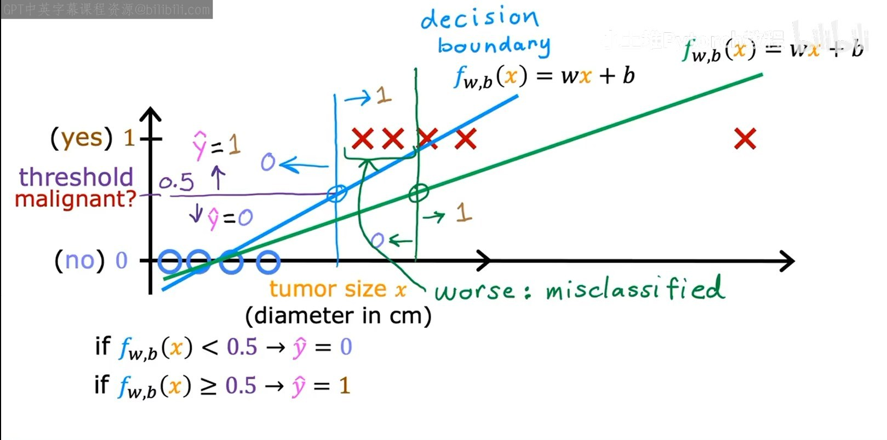

# 逻辑回归

## 为什么不用线性回归直接分类

二元分类的 `0`、`1` 是人为约定的类别编码，不表示好坏。例如日志告警中，`1` 表示需要告警，`0` 表示不需要。

线性回归的输出没有限制在 `[0, 1]`，不能直接当作概率。若拟合 `0/1` 标签后再用 `0.5` 切分类别，额外样本可能拉动拟合直线，使决策边界移动。下面的例子中，新增远端样本后，原本正确分类的一些样本被误分类：



这是线性回归直接用于分类的局限示例，不表示添加数据必然使所有分类模型变差。逻辑回归虽然名称包含“回归”，实际用于分类。

## 从线性得分到概率

逻辑回归先计算线性得分，再通过 sigmoid 函数转换为概率估计：

```text
z = X @ w + b
p = sigmoid(z) = 1 / (1 + e^(-z))
```

`e ≈ 2.718` 是数学常数，负指数表示取倒数，例如 `e^(-2) = 1 / e²`。NumPy 中指数运算写成 `np.exp(...)`。

对有限的实数 `z`，数学上的 sigmoid 值位于 `(0, 1)`；`z` 越大，概率越接近 `1`，`z = 0` 时概率为 `0.5`。它表示**模型估计标签为 `1` 的概率**，不等于真实标签，也不保证估计完全准确。

| 概念 | 含义 | 例子 |
| --- | --- | --- |
| 概率 `p` | 模型给出的概率估计 | `0.25`，估计需要告警的概率为 25% |
| 预测标签 | 根据阈值作出的分类决策 | 阈值 `0.5` 时，`p = 0.25` 被判为 `0` |
| 真实标签 `y` | 数据中给出的实际类别 | 用来检查预测是否正确 |

规则为 `p >= threshold` 时预测 `1`，否则预测 `0`。改变阈值只改变决策，不改变概率本身：例如 `p = 0.6`，阈值为 `0.5` 时判为 `1`，改为 `0.7` 时判为 `0`。

## 二元交叉熵

分类损失评价的是概率预测。设模型分配给**真实类别**的概率为 `q`：

- `y = 1` 时，`q = p`。
- `y = 0` 时，`q = 1 - p`。

单样本损失为 `-log(q)`。这里使用自然对数，它是以 `e` 为底的指数运算的逆运算：`e^a = q` 等价于 `log(q) = a`。

| 真实类别的概率 `q` | 损失 `-log(q)` |
| ---: | ---: |
| `0.9` | 约 `0.105` |
| `0.5` | 约 `0.693` |
| `0.1` | 约 `2.303` |

给真实类别的概率越低，损失越大；对错误判断越自信，惩罚越大。将两种标签合并，再对样本取平均，得到二元交叉熵：

```text
L_i = -[y_i × log(p_i) + (1 - y_i) × log(1 - p_i)]
J = Σ L_i / m
```

当 `y = 1` 时只保留 `-log(p)`；当 `y = 0` 时只保留 `-log(1-p)`。`np.mean()` 在下面的实现中对当前批次的逐样本损失取平均。

## 给定参数的最小计算

以下从日志告警实验中保留概率、损失和错误统计的最小计算，使用固定参数。沿用 `X: (m,n)`、`w: (n,)`、`y: (m,)`，样本数 `m > 0`：

```python
import numpy as np

X = np.array([[-2], [-0.5], [0.2], [0.5], [2]], dtype=float)
y = np.array([0, 1, 0, 1, 1])
w = np.array([1.0])
b = 0.0


def sigmoid(z):
    return 1 / (1 + np.exp(-z))


def binary_cross_entropy(y, p):
    p = np.clip(p, 1e-15, 1 - 1e-15)
    return -np.mean(y * np.log(p) + (1 - y) * np.log(1 - p))


p = sigmoid(X @ w + b)
loss = binary_cross_entropy(y, p)
predicted = (p >= 0.5).astype(int)
fp = np.sum((predicted == 1) & (y == 0))
fn = np.sum((predicted == 0) & (y == 1))
```

例如第三条样本标签为 `0`，模型却给出约 `0.55` 的正类概率；阈值为 `0.5` 时，它是一条误报。`np.clip` 用于避免 `log(0)`；触及裁剪边界时算的是裁剪后的损失，而非原始概率的精确交叉熵。本例没有触及边界，完整概率与输出见文末源码。

数组条件组合使用 `(条件一) & (条件二)`，`np.sum` 统计满足条件的数量。预测标签通过 `.astype(int)` 将布尔数组转换为 `0/1`。

## 阈值与错误代价

| 错误类型 | 真实标签 | 预测标签 | 日志例子 |
| --- | ---: | ---: | --- |
| 误报 FP | `0` | `1` | 正常日志被报为异常 |
| 漏报 FN | `1` | `0` | 真正异常的日志未告警 |

同一组概率，改变阈值得到：

| 阈值 | 预测标签 | 错误总数 | FP | FN |
| ---: | --- | ---: | ---: | ---: |
| `0.5` | `[0, 0, 1, 1, 1]` | `2` | `1` | `1` |
| `0.7` | `[0, 0, 0, 0, 1]` | `2` | `0` | `2` |

错误总数相同，错误类型却不同。在漏报代价更高的情境中，这两个候选里更倾向阈值 `0.5`；但是不能据此认定它对所有任务都最好。

**交叉熵使用概率，分类错误使用阈值后的标签。** 改阈值时参数与概率没变，交叉熵不变，FP/FN 却可能改变；交叉熵能区分概率质量，而不只是统计分类对错。实际选阈值属于方案调整，应使用验证数据，保留最终测试集作独立评价。

## 链式法则与分类梯度

参数通过“权重 → 得分 `z` → 概率 `p` → 损失 `L`”影响结果。链式法则把沿途变化率相乘：

```text
dL/dw_j = (dL/dp) × (dp/dz) × (dz/dw_j)
```

不能只求损失对中间量的变化率，就当作对权重的变化率。由于 `z = Σ w_j x_j + b`，还有 `dz/dw_j = x_j`、`dz/db = 1`。

自然对数的导数为 `d(log p)/dp = 1/p`；sigmoid 的导数为 `dp/dz = e^(-z)/(1+e^(-z))² = p(1-p)`。对前文的单样本交叉熵，分别代入两种标签：

| 标签 | 损失 `L` | `dL/dp` | 乘以 `dp/dz` 后 |
| --- | --- | --- | --- |
| `y = 1` | `-log(p)` | `-1/p` | `p - 1` |
| `y = 0` | `-log(1-p)` | `1/(1-p)` | `p` |

两种情况统一为 `dL/dz = p-y`，再乘对应特征、对样本取平均：

```text
dw_j = Σ[(p_i - y_i) × X_ij] / m
db   = Σ(p_i - y_i) / m

dw = X.T @ (p-y) / m
db = np.mean(p-y)
```

这里仍是对样本求平均，每个权重使用对应的特征列；`dw` 的形状与 `w` 一致。梯度中的 `p` 是概率，不能换成阈值后的 `0/1` 类别，因为阈值不在这条交叉熵计算链中。

例如 `x=2、w=0、b=0、y=1` 时，`p=0.5`，三段变化率为 `(-2) × 0.25 × 2 = -1`，应略微增大权重以降低损失；漏掉最后的特征系数 `2` 就会算错。

## 从零参数训练

复用前文的 `X`、`y`、`sigmoid` 和交叉熵函数，重新从零权重、零偏置开始。以下按训练实验精简整理：

```python
def gradients_logistic(X, y, w, b):
    p = sigmoid(X @ w + b)
    return X.T @ (p - y) / len(y), np.mean(p - y)


def train_logistic(X, y, w, b, learning_rate, steps):
    history = [binary_cross_entropy(y, sigmoid(X @ w + b))]
    for _ in range(steps):
        dw, db = gradients_logistic(X, y, w, b)
        w -= learning_rate * dw
        b -= learning_rate * db
        history.append(binary_cross_entropy(y, sigmoid(X @ w + b)))
    return w, b, history


w_fit, b_fit, history_fit = train_logistic(
    X, y, np.zeros(X.shape[1]), 0.0, learning_rate=0.1, steps=1000
)
p_fit = sigmoid(X @ w_fit + b_fit)
predicted_fit = (p_fit >= 0.5).astype(int)
```

每轮用同组旧参数计算全部梯度，再更新并记录新参数的损失。这里 `history` 含初始状态，因此长度为 `steps + 1`；它记录优化过程，不是验证集表现。梯度公式对应未裁剪的 sigmoid 交叉熵，不能用阈值标签代替概率；极端数值处的裁剪会改变损失，不能据此认为裁剪后的数值函数与上述梯度处处完全一致。

**梯度与更新后的参数不同。** 例如本例初始偏置为 `0`、`db = -0.1`，学习率为 `0.1`，则 `b_new = 0 - 0.1 × (-0.1) = 0.01`。负梯度使本次偏置增加，不能把 `0.01` 当作偏置梯度。

### 损失下降，错误总数为何不变

损失连续评价概率，分类错误只看概率位于阈值哪一侧，因此损失下降不保证错误总数下降，需要区分两种机制：

- 概率改善但没有跨过阈值，预测类别保持不变。
- 有些样本由错变对，另一些由对变错，总错误数恰好抵消。

前文五样本从零参数训练时，阈值固定为 `0.5`：初始概率全为 `0.5`，全部判为 `1`；训练后标签为 `[0, 0, 1, 1, 1]`。第一条由错变对，第二条由对变错，损失约从 `0.693` 降为 `0.470`，错误数仍为 `2`，属于第二种情况。

因此应核对逐样本预测，不能只凭总数套用“概率没有越过阈值”的解释。

## 决策边界与近边界检查

决策边界是预测类别发生分界的位置，由特征表示、模型参数和阈值共同决定。阈值为 `0.5` 时，sigmoid 对应的得分为 `0`：一维边界满足 `wx+b=0`，二维得分如 `z=x₁+x₂-3` 的边界为 `x₁+x₂=3`。

对一般概率阈值 `t`，令边界处 `p=t`：

```text
t = 1 / (1 + e^(-z))
e^(-z) = (1-t) / t
z = log(t / (1-t))

x_boundary = [log(t / (1-t)) - b] / w
```

一维解式要求 `0 < t < 1` 且 `w != 0`。阈值为 `0.5` 时，退化为 `x_boundary = -b/w`。本例权重为正，边界左侧判为 `0`、右侧判为 `1`；权重为负时方向反转。

```python
def boundary_x(weight, bias, threshold):
    return (np.log(threshold / (1 - threshold)) - bias) / weight


edge_05 = boundary_x(w_fit[0], b_fit, 0.5)
edge_07 = boundary_x(w_fit[0], b_fit, 0.7)
```

根据边界位置，在两侧各选一个附近输入，再经过完整前向计算检查概率和类别，可以验证“解出的边界”与实际预测是否一致。权重为正时，边界左侧概率低于阈值、右侧高于阈值；改变概率阈值也会移动输入空间中的边界。

**不能将线性得分直接与概率阈值比较。** 例如前文第三条输入的得分 `z = 0.2`、概率约为 `0.55`，阈值 `0.5` 下应判为 `1`，但误用 `z >= 0.5` 会判为 `0`。等价的得分判断应使用 `z >= log(t/(1-t))`，而不是 `z >= t`。

远离边界的点可能恰好让两种写法给出相同类别；选边界附近的点更容易暴露混用。以上训练与边界检查使用构造数据，不构成独立泛化评估。

实验源码与完整结果：[逻辑回归实验](https://github.com/lumikok/ai-learning-lab/blob/main/04-logistic-regression/README.md)，对应 `01-prediction_and_loss.py` 与 `02-logistic_training.py`。图为课程截图。
