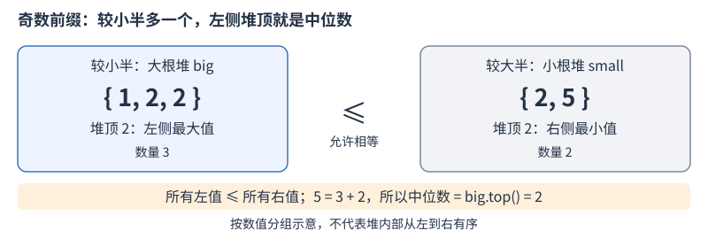

# 堆

堆适合“元素不断加入，每次只需取出当前最大值或最小值”的需求。它不是把所有元素始终排好序，而是维护堆顶可直接取得极值的局部关系。

## 堆序保证什么

二叉堆在形状上是一棵完全二叉树，除最后一层外各层填满，最后一层从左到右紧凑排列，因此树高为 O(log n)。

- 大根堆：每个父节点都不小于孩子，因此根节点是最大值。
- 小根堆：每个父节点都不大于孩子，因此根节点是最小值。

左右孩子之间没有排序要求。例如根为 `9`、左右孩子分别为 `2`、`5`，已经满足大根堆；不能据此认为整棵树按从左到右有序。

插入和删除堆顶时，需要恢复堆序，调整沿树高方向进行。理解这些局部约束即可使用标准库，不必先手写一套堆存储与调整程序。

## C++ 优先队列的操作

`priority_queue<int>` 默认最大值优先；`priority_queue<int, vector<int>, greater<int>>` 则最小值优先。后者用到 `<queue>`、`<vector>` 和 `<functional>`。

| 操作 | 含义 | 代价 |
|---|---|---|
| `top()` | 查看堆顶，不删除 | O(1) |
| `push(x)` | 插入一个元素，恢复堆序 | 堆调整 O(log n) |
| `pop()` | 删除堆顶，不返回被删元素 | O(log n) |

接口行为和堆调整界限分别见 [C++ 草案：priority_queue](https://eel.is/c++draft/priority.queue) 与[堆操作](https://eel.is/c++draft/alg.heap.operations)。默认底层 `vector` 偶尔会扩容并移动元素，所以 `push` 的整体代价通常按摊还 O(log n) 计，不能把每一次插入都理解成只做对数次数据搬移。

空堆上不能直接调用 `top()` 或 `pop()`。如果既要获取又要删除，应先读取 `top()`，再执行 `pop()`；不要写成接收 `pop()` 的返回值。

## 小根堆：重复值与空状态

下面整理自训练文件 `re/priority/1.cpp`：保留操作规则、小根堆、重复值及空堆处理，提取为接收输入输出流的函数，使用明确头文件并补充步骤注释。

输入先给操作数，随后每条操作为 `1 x`（加入整数 `x`）或 `2`（输出并删除当前最小值，空时输出 `EMPTY`）。

```cpp
#include <functional>
#include <iostream>
#include <queue>
#include <vector>
using namespace std;

// 前提：输入满足上面的两类操作格式，加入的数值可存入 int。
void processMinHeap(istream& in, ostream& out) {
    int count;
    in >> count;
    priority_queue<int, vector<int>, greater<int>> q;
    while (count--) {
        int operation;
        in >> operation;
        if (operation == 1) {
            int x;
            in >> x;
            q.push(x);  // 1. 每次插入都保留；相同值不是同一个元素。
        } else if (operation == 2) {
            if (q.empty()) {  // 2. 先判空，再读取或删除堆顶。
                out << "EMPTY\n";
                continue;
            }
            out << q.top() << '\n';  // 3. 先读到当前最小值。
            q.pop();                 // 4. 删除这一个元素，恢复堆序。
        }
    }
}
```

依次执行“加入 `5`、加入 `2`、加入 `2`、取出、加入 `3`、连续取出四次”，输出为 `2、2、3、5、EMPTY`。这个例子同时检查重复值被分别保存、每次删除后堆顶更新，以及取空之后的处理。

若最多同时保存 `k` 个元素，容器空间为 O(k)；对 `Q` 次操作，总时间上界可写为 O(Q log(Q+1))。堆只解决动态极值的维护，不直接提供任意元素查询或全局有序遍历。

## 动态合并：代价、贪心与总操作数

[P1090 合并果子](https://www.luogu.com.cn/problem/P1090) 每次合并两堆，花费为两堆重量之和，新堆继续参与后续合并。要维护的是**当前所有堆**中最轻的两堆，而不是只将初始重量排序一次后，相邻两两合并。

例如重量 `2、3、6、8`：先合并 `2+3=5`，再合并 `5+6=11`，最后合并 `8+11=19`，总花费是 `5+11+19=35`，不是最终重量 `19`。

### 为什么总选最轻的两堆

把原堆看成叶子、每次合并看成父节点，最终得到一棵合并树。一个原始重量每经过一次合并，就被计费一次，因此总花费为：

```text
Σ 原始重量 × 该叶子到根的深度
```

树的最深处存在一对同父叶子。把最小的两个重量交换到这对位置不会增加代价：较小重量放到更深的位置，较大重量移到不更深的位置，交换前后的差额不为正。因此存在一个最优方案，让最小两堆互为兄弟、先合并。

将它们收缩为重量 `a+b` 的一堆后，已付代价 `a+b` 固定，剩余仍是同类问题，故可以反复采用这个选择。堆只是高效维护选择的工具，不能用“用了小根堆”替代贪心正确性的理由。

下面从训练文件 `01_date/2026-10/P1090.cpp` 提取合并过程为函数，保留取两堆、计费、放回的顺序，并把堆元素也统一为 `long long`；原源码的堆元素为 `int`，累计值为 `long long`。

```cpp
#include <functional>
#include <queue>
#include <vector>
using namespace std;

// 前提：weights 非空，元素为正；数值范围沿用 P1090。
long long minMergeCost(const vector<int>& weights) {
    priority_queue<long long, vector<long long>, greater<long long>> q;
    for (int weight : weights) q.push(weight); // 1. 建立当前候选集合。
    long long answer = 0;
    while (q.size() > 1) {
        long long a = q.top(); q.pop();
        long long b = q.top(); q.pop();       // 2. 取当前最轻的两堆。
        answer += a + b;                     // 3. 本轮代价计入累计值。
        q.push(a + b);                       // 4. 新堆重新参加选择。
    }
    return answer; // 只有一堆时没有合并，花费为零。
}
```

逐个插入 `n` 个元素，之后进行 `n-1` 轮合并，每轮两次删除、一次插入，总操作数为 O(n)。一次堆操作为 O(log n)，所以**总时间 O(n log n)**，不是 O(log n)；空间 O(n)。

## 多路有序候选：每路只保留当前最小项

[P1631 序列合并](https://www.luogu.com.cn/problem/P1631) 给出两个长度为 `n` 的非降序列，只求 `n²` 个两两和中最小的 `n` 个。固定 `i` 后，每一路为：

```text
a[i]+b[0], a[i]+b[1], ..., a[i]+b[n-1]
```

因为 `b` 非降，这一路也非降。堆中始终保留**每路尚未输出部分的最小项**：初始放每路第一项，弹出某路后，仅补入该路的下一项。未入堆的项前面都有本路候选，不可能比所有路候选的最小值更小，因此不会漏掉下一答案。

下面整理自 `01_date/2026-10/P1631.cpp`，将下标改为 `0` 起始、输出改为返回数组，保留候选的和及两个位置；比较器加上只读限定并重命名。

```cpp
#include <queue>
#include <vector>
using namespace std;

struct SumCandidate {
    long long sum;
    int row, column;
};
struct GreaterSum {
    bool operator()(const SumCandidate& a, const SumCandidate& b) const {
        return a.sum > b.sum; // 较大和的优先级更低，堆顶取得最小和。
    }
};

// 前提：a、b 非空、等长且非降，数值范围沿用 P1631。
vector<long long> smallestPairSums(const vector<long long>& a,
                                   const vector<long long>& b) {
    int n = static_cast<int>(a.size());
    priority_queue<SumCandidate, vector<SumCandidate>, GreaterSum> q;
    for (int i = 0; i < n; ++i) q.push({a[i] + b[0], i, 0});
    vector<long long> answer;
    for (int count = 0; count < n; ++count) {
        SumCandidate current = q.top(); q.pop();
        answer.push_back(current.sum); // 1. 输出所有路中当前最小的候选。
        int next = current.column + 1;
        if (next < n) {                // 2. 只推进刚输出的那一路。
            q.push({a[current.row] + b[next], current.row, next});
        }
    }
    return answer;
}
```

`priority_queue` 的比较器不是“返回真就放到堆顶”：这里 `a.sum>b.sum` 让较大项排在较低优先级。相同和互不优先也没问题，答案只要求数值顺序；不能为了去重改用集合，因为不同下标对可以产生相同的和，它们仍是不同候选。

例如 `a=[1,2]、b=[1,3]`，各路为 `[2,4]`、`[3,5]`，前两个和为 `[2,3]`。初始化和输出都只有 O(n) 次堆操作，堆内至多 `n` 个候选，时间 O(n log n)、空间 O(n)，无需显式生成 `n²` 个和。

## 双堆：分区正确，数量也要平衡



先看数值分区，再看元素数量。图中展示分组与堆顶，不代表堆内部按从左到右排序。

- 左侧 `big` 是大根堆，保存较小的一半；右侧 `small` 是小根堆，保存较大的一半。两边均非空时，要求 `big.top()<=small.top()`。
- 数量只能相等，或左侧比右侧多一个。每次加入一个元素后，若失衡，就把较多侧的边界元素移到另一侧。
- 总数为奇数时，左侧多出的那个边界值就是中位数，直接读取 `big.top()`；[P1168](https://www.luogu.com.cn/problem/P1168) 只输出前奇数项的中位数。

容易混淆的是把分区关系写成严格小于：重复值可以分布在两侧，所以必须允许相等，不能要求 `big.top()<small.top()`。

下面整理自 `01_date/2026-10/P1168.cpp`，保留原插入、搬移和奇数项输出逻辑，提取为返回结果数组的函数。

```cpp
#include <functional>
#include <queue>
#include <vector>
using namespace std;

vector<int> oddPrefixMedians(const vector<int>& values) {
    priority_queue<int> big;
    priority_queue<int, vector<int>, greater<int>> small;
    vector<int> answer;
    int count = 0;
    for (int x : values) {
        // 1. 按当前左右分界插入，保持左侧所有值不大于右侧。
        if (big.empty() || x <= big.top()) big.push(x);
        else small.push(x);
        // 2. 恢复数量关系；每次只加入一个值，一次搬移即可修正。
        if (big.size() > small.size() + 1) {
            small.push(big.top()); big.pop();
        }
        if (small.size() > big.size()) {
            big.push(small.top()); small.pop();
        }
        // 3. 在两种约束都恢复后，输出奇数前缀的中位数。
        if (++count % 2 == 1) answer.push_back(big.top());
    }
    return answer;
}
```

每个输入触发常数次堆操作，总时间 O(n log n)，空间 O(n)，包含两个堆和结果数组。偶数前缀仍要恢复平衡，但当前函数不输出偶数项中位数，也没有把两个堆顶平均值当成原题答案。
