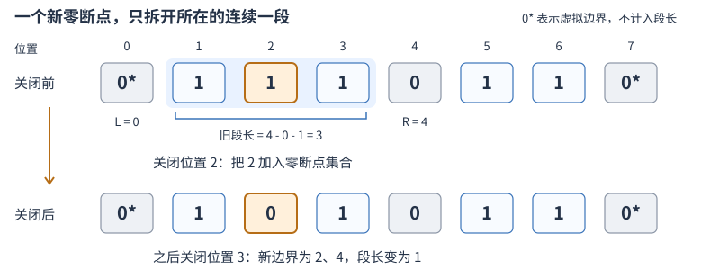

# 有序集合

## 月赛 C：用零断点维护连续段

SWJTU ACM2026 月赛 C「meaningless [C]ode」（2026-10-25）：给定 01 字符串，依次关闭指定位置。该位置为 `1` 时，消耗它所在的极长连续 `1` 段的长度，再将它改成 `0`；已经为 `0` 则不消耗。求总消耗。题面范围为 `n<=10^6`、`q<=10^5`，操作位置在 `1..n`。

### 用左右断点代替整段扫描



从上到下读图：每个格子对应一个位置，`0、7` 是虚拟边界。关闭前先读旧边界，再加入新断点。

- 对仍为 `1` 的位置 `2`，最近零位置为 `L=0、R=4`，段长为 `4-0-1=3`。
- 关闭 `2` 后，插入零断点 `2`，原段被分成位置 `1` 和位置 `3` 两段；右侧的 `5、6` 不受影响。
- 再关闭 `3` 时，新边界变成 `2、4`，消耗为 `1`。重复关闭 `3` 则消耗为 `0`。

容易混淆的是把边界间的距离当成段长：两个零本身不属于连续一段，所以应减一，不能用 `R-L`。

集合始终保存全部真实零和两个哨兵。对未关闭位置 `i`，用成员 `upper_bound(i)` 找右边界，再用 `prev` 找左边界；查询、插入及迭代器边界的共用机制见[有序集合与邻居查询](../notes/algorithms/data-structures/有序集合.md)。

### 整理实现

下面整理自训练文件 `01_date/2026-10/yuesai/c.cpp`，保留最终有序集合方案，提取为函数并将集合改名为 `zeros`。为突出“使用旧段长，再更新断点”，把累计移到插入之前；原实现先插入再读取旧迭代器也成立，因为 `set` 插入不使它们失效。

```cpp
#include <iterator>
#include <set>
#include <string>
#include <vector>
using namespace std;

// 前提：s 是非空 01 串；operations 中的位置均在 [1,s.size()] 内。
long long shutdownEnergy(string s, const vector<int>& operations) {
    int n = static_cast<int>(s.size());
    set<int> zeros = {0, n + 1}; // 1. 两个虚拟零保证首尾段也有左右边界。
    for (int i = 0; i < n; ++i) {
        if (s[i] == '0') zeros.insert(i + 1);
    }

    long long answer = 0;
    for (int position : operations) {
        if (s[position - 1] == '0') continue; // 2. 重复关闭或初始为零不计费。
        auto right = zeros.upper_bound(position);
        auto left = prev(right); // 两个哨兵和合法操作位置保证前驱存在。
        answer += *right - *left - 1;        // 3. 累计关闭前的旧段长度。
        zeros.insert(position);             // 4. 插入断点，影响之后的查询。
        s[position - 1] = '0';
    }
    return answer;
}
```

直接在每次操作中向左右扫描，会反复经过仍为 `1` 的位置。全一串从左向右关闭时，各次扫描长度依次为 `n、n-1、……`，不能因为每个位置最终只关闭一次，就把总扫描量算成 O(n)。

维护零集合后，初始化逐个插入至多 `n` 个零，每次有效关闭只做邻居查询和一次插入，时间上界 O((n+q) log(n+2))，额外空间 O(n)，包含函数中的字符串副本；没有为每次查询重新扫描整段。

单次段长不超过 `n`，但累计量不能用 `int`。例如 `n=q=100000` 的全一串依次关闭 `1..n`，总消耗为 `n(n+1)/2=5000050000`。这里每次相减可用 `int`，累计答案必须使用 `long long`。
